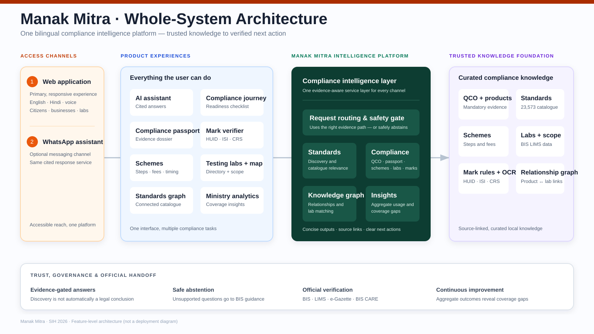
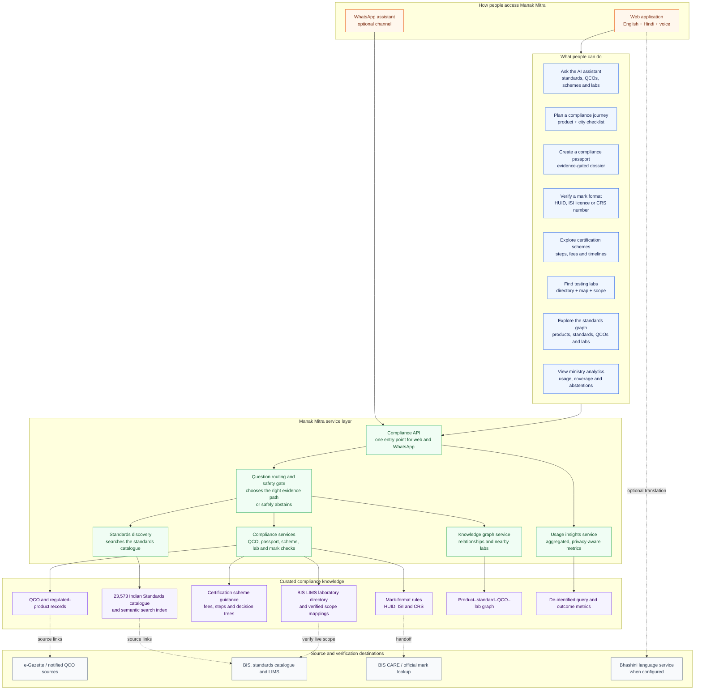

# Manak Mitra — Whole-System Architecture

This is the single-slide, executive view of the complete platform. It is
designed for a presentation: access sits on the left, product experiences and
the intelligence platform sit in the middle, and the trusted knowledge base is
on the right. It intentionally avoids a step-by-step user flow.

The editable landscape canvas is available as
[architecture-whole-system.excalidraw](architecture-whole-system.excalidraw).

## Slide-ready whole-system view

## Slide message

**Manak Mitra turns trusted BIS compliance knowledge into one bilingual
experience for citizens, businesses, labs and ministries—across answers,
compliance actions and decision-support analytics.**

## Presentational boundary

A catalogue match is **discovery**, not an automatic legal conclusion. A
Compliance Passport is evidence-gated, and mark verification checks format
before directing users to the official registry for live confirmation.
